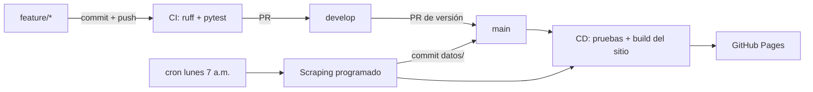

# Monitor de precios Falabella – Redmi Buds 6 Play

[](https://github.com/Biershoot/monitor-precios-falabella/actions/workflows/ci.yml)
[](https://github.com/Biershoot/monitor-precios-falabella/actions/workflows/cd.yml)
[](https://github.com/Biershoot/monitor-precios-falabella/actions/workflows/scraping.yml)

Proyecto de la **Evidencia de aprendizaje 2 – Optimizando la productividad en el mundo del software**
(Programación para Análisis de Datos, IU Digital de Antioquia).

En la Evidencia 1 hice web scraping de Falabella Colombia con BeautifulSoup, Selenium y Scrapy
para saber qué tan competitivos son los audífonos **Xiaomi Redmi Buds 6 Play** frente al resto del
catálogo de audífonos inalámbricos. Ese análisis era una "foto" de un solo día y se corría a mano
desde un notebook.

En esta evidencia convertí ese código en un **proyecto de software versionado con Git y GitHub**,
con **pruebas automatizadas** y un **pipeline de CI/CD en GitHub Actions** que:

1. corre el lint y las pruebas en cada push y en cada pull request (CI),
2. publica un tablero con los resultados en **GitHub Pages** cada vez que hay cambios en `main` (CD),
3. repite el scraping **cada lunes** de forma automática y guarda el historial de precios.

**Sitio publicado:** https://biershoot.github.io/monitor-precios-falabella/

---

## Estructura del repositorio

```
monitor-precios-falabella/
├── monitor_precios/            # Paquete de Python
│   ├── extraccion.py           # Descarga y lectura del JSON __NEXT_DATA__ de Falabella
│   ├── limpieza.py             # Limpieza del catálogo (repetidos, precios, descuentos)
│   ├── analisis.py             # Indicadores del artículo frente al catálogo e historial
│   ├── reporte.py              # Gráficas y sitio estático (HTML)
│   └── __main__.py             # Comandos: scrapear / reporte
├── tests/                      # Pruebas con pytest (sin internet, con HTML de ejemplo)
├── datos/
│   ├── catalogos/              # Un CSV por cada fecha de extracción
│   ├── catalogo_ultimo.csv     # Última extracción
│   ├── articulo_ultimo.json    # Ficha del artículo en la última extracción
│   └── historial.csv           # Indicadores de cada fecha (va creciendo cada semana)
├── notebooks/                  # Notebook con el proceso explicado paso a paso
├── docs/flujo-devops.md        # Explicación detallada del flujo de trabajo
├── .github/
│   ├── workflows/ci.yml        # Integración continua
│   ├── workflows/cd.yml        # Despliegue continuo en GitHub Pages
│   ├── workflows/scraping.yml  # Scraping programado semanal
│   └── pull_request_template.md
├── pyproject.toml              # Configuración de pytest, coverage y ruff
├── requirements.txt
└── requirements-dev.txt
```

## Cómo ejecutarlo en local

```bash
git clone https://github.com/Biershoot/monitor-precios-falabella.git
cd monitor-precios-falabella
python -m venv .venv
.venv\Scripts\activate          # en Linux/Mac: source .venv/bin/activate
pip install -r requirements-dev.txt

ruff check .                    # revisar estilo
pytest --cov                    # correr las pruebas con cobertura
python -m monitor_precios scrapear      # extraer datos nuevos (respeta robots.txt)
python -m monitor_precios reporte       # generar el sitio en la carpeta sitio/
```

Después se abre `sitio/index.html` en el navegador.

## Flujo de trabajo DevOps



### Ramas

| Rama | Para qué se usa |
|------|-----------------|
| `main` | Versión estable. Todo lo que llega aquí se despliega. Solo recibe cambios por pull request. |
| `develop` | Rama de integración donde se juntan las funcionalidades terminadas. |
| `feature/<nombre>` | Una rama por funcionalidad (extracción, pruebas, reporte, CI, CD...). Sale de `develop` y vuelve por PR. |
| `fix/<nombre>` | Correcciones de errores. |

### Convención de commits

Uso mensajes cortos en español con un prefijo que dice el tipo de cambio
(basado en *Conventional Commits*):

- `feat:` nueva funcionalidad · `fix:` corrección · `test:` pruebas
- `ci:` workflows de GitHub Actions · `docs:` documentación · `chore:` configuración · `datos:` datos nuevos

### Pipeline

| Workflow | Cuándo se ejecuta | Qué hace |
|----------|-------------------|----------|
| `ci.yml` | push a cualquier rama distinta de `main` y PR hacia `main`/`develop` | Instala dependencias, revisa estilo con **ruff**, corre **pytest** en Python 3.11 y 3.12 con cobertura mínima de 85 % y verifica que el sitio se pueda generar. |
| `cd.yml` | push a `main` (PR fusionado), manual o llamado por el scraping | Vuelve a correr la CI, genera el sitio estático y lo publica en **GitHub Pages**. |
| `scraping.yml` | todos los lunes a las 12:00 UTC o manual | Ejecuta el scraper, hace commit de los CSV nuevos en `datos/` y llama al despliegue. Si salen menos de 100 productos falla y no guarda nada. |

Más detalle en [docs/flujo-devops.md](docs/flujo-devops.md).

## Scraping responsable

- Antes de extraer se revisa el `robots.txt` de Falabella (permite todos los robots salvo el carrito y la cuenta).
- Pausa de 1,5 a 2 segundos entre páginas y solo 5 páginas por ejecución, una vez por semana.
- Solo se guardan datos públicos de productos (nada de datos personales).

## Autor

Alejandro Arango Calderón – Programación para Análisis de Datos, grupo PREICA2602B020048.
Docente: Andrés Felipe Palacio.
