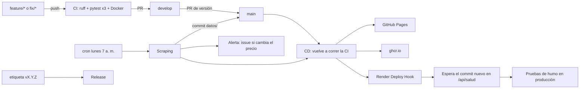

# Monitor de precios Falabella – Redmi Buds 6 Play

[](https://github.com/Biershoot/monitor-precios-falabella/actions/workflows/ci.yml)
[](https://github.com/Biershoot/monitor-precios-falabella/actions/workflows/cd.yml)
[](https://github.com/Biershoot/monitor-precios-falabella/actions/workflows/scraping.yml)

Proyecto del curso **Programación para Análisis de Datos** (IU Digital de Antioquia), construido a lo largo de tres evidencias:

| Evidencia | Qué se hizo |
|-----------|-------------|
| EA1 – Análisis y herramientas de extracción de datos | Web scraping de Falabella Colombia con BeautifulSoup, Selenium y Scrapy para saber qué tan competitivos son los audífonos **Xiaomi Redmi Buds 6 Play**. |
| EA2 – Optimizando la productividad | El scraper pasó a ser un paquete de Python con Git, ramas, pull requests, pruebas con pytest y un pipeline de CI/CD que publica un reporte en GitHub Pages y repite el scraping cada lunes. |
| **EA3 – Optimización de procesos de desarrollo** | **Aplicación web Flask** (tablero, catálogo con filtros y API REST) en un contenedor Docker, **desplegada en Render** de forma automática desde GitHub Actions, con pruebas de humo en producción, imagen publicada en ghcr.io, alertas de precio, releases y Dependabot. |

**Aplicación web (Render):** https://monitor-precios-falabella.onrender.com
**Reporte estático (GitHub Pages):** https://biershoot.github.io/monitor-precios-falabella/

> El plan gratis de Render apaga el servicio después de 15 minutos sin visitas. La primera visita después de eso puede tardar alrededor de un minuto mientras el contenedor vuelve a arrancar.

---

## Contenido

1. [Introducción](#introducción)
2. [Estructura del repositorio](#estructura-del-repositorio)
3. [Instalación](#instalación)
4. [Uso](#uso)
5. [API REST](#api-rest)
6. [Automatización con GitHub Actions](#automatización-con-github-actions)
7. [Despliegue en Render](#despliegue-en-render)
8. [Flujo de trabajo con Git](#flujo-de-trabajo-con-git)
9. [Scraping responsable](#scraping-responsable)

## Introducción

El proyecto responde a una pregunta concreta: **¿los Redmi Buds 6 Play son una buena compra frente al resto de audífonos que vende Falabella?** Para eso se extrae el catálogo de audífonos, se limpia, se calculan indicadores (precio mediano, porcentaje de productos más baratos que el artículo, descuentos, marcas) y se guarda un historial semanal.

En la EA3 el resultado dejó de ser solo un HTML estático: ahora es una **aplicación web** que cualquier persona puede consultar desde el navegador o desde otro programa a través de la API, y que se actualiza sola cada vez que llegan datos nuevos o se fusiona un cambio en `main`.

## Estructura del repositorio

```
monitor-precios-falabella/
├── monitor_precios/              # Paquete de Python
│   ├── extraccion.py             # Descarga y lectura del JSON __NEXT_DATA__ de Falabella
│   ├── limpieza.py               # Limpieza del catálogo (repetidos, precios, descuentos)
│   ├── analisis.py               # Indicadores, historial y detección de cambios de precio
│   ├── reporte.py                # Sitio estático con matplotlib (GitHub Pages)
│   ├── __main__.py               # CLI: scrapear | reporte | alerta | servidor
│   └── web/                      # Aplicación web (EA3)
│       ├── __init__.py           # create_app(): rutas HTML y API REST
│       ├── config.py             # Configuración por variables de entorno
│       ├── datos.py              # Lectura de datos/ con caché, filtros e histograma
│       ├── templates/            # Plantillas Jinja2 (tablero, catálogo, error)
│       └── static/estilos.css
├── tests/                        # 68 pruebas con pytest (sin internet)
├── datos/                        # Catálogos, ficha del artículo e historial
├── docs/
│   ├── flujo-devops.md           # Flujo de trabajo DevOps paso a paso
│   └── despliegue-render.md      # Guía de despliegue en Render
├── notebooks/                    # Notebooks de la EA2 y la EA3
├── .github/
│   ├── workflows/ci.yml          # Lint, pruebas (3 versiones de Python) y prueba del contenedor
│   ├── workflows/cd.yml          # GitHub Pages + ghcr.io + Render + pruebas de humo
│   ├── workflows/scraping.yml    # Scraping semanal, commit de datos, alerta y redespliegue
│   ├── workflows/release.yml     # Release automático al subir una etiqueta vX.Y.Z
│   ├── dependabot.yml            # Actualización semanal de dependencias
│   └── pull_request_template.md
├── Dockerfile                    # Imagen de producción (gunicorn, usuario sin privilegios)
├── .dockerignore
├── render.yaml                   # Blueprint de Render (infraestructura como código)
├── pyproject.toml                # Configuración de pytest, coverage y ruff
├── requirements.txt              # Dependencias de la aplicación
└── requirements-dev.txt          # + pytest, pytest-cov y ruff
```

## Instalación

Requisitos: Python 3.11 o superior y Git. Docker es opcional.

```bash
git clone https://github.com/Biershoot/monitor-precios-falabella.git
cd monitor-precios-falabella
python -m venv .venv
.venv\Scripts\activate            # en Linux/Mac: source .venv/bin/activate
pip install -r requirements-dev.txt
```

## Uso

```bash
ruff check .                              # revisar estilo
pytest --cov                              # 68 pruebas con cobertura
python -m monitor_precios servidor        # aplicación web en http://127.0.0.1:5000
python -m monitor_precios scrapear        # extraer datos nuevos (respeta robots.txt)
python -m monitor_precios alerta          # ¿cambió el precio entre las dos últimas fechas?
python -m monitor_precios reporte         # generar el sitio estático en sitio/
```

Con Docker (igual a como corre en Render):

```bash
docker build -t monitor-precios .
docker run -p 10000:10000 monitor-precios     # http://localhost:10000
```

### Variables de entorno

| Variable | Valor por defecto | Para qué sirve |
|----------|-------------------|----------------|
| `PORT` | `5000` en local, `10000` en Docker | Puerto en el que escucha el servidor (Render lo asigna). |
| `APP_ENV` | `development` | `production` en Render. Se muestra en el pie de página y en `/api/salud`. |
| `DATOS_DIR` | `datos` | Carpeta con `catalogo_ultimo.csv`, `articulo_ultimo.json` e `historial.csv`. |
| `LIMITE_MAXIMO` | `500` | Máximo de productos que devuelve `/api/catalogo` por consulta. |
| `POR_PAGINA` | `50` | Productos por página en `/catalogo`. |
| `WEB_CONCURRENCY` | `2` | Número de procesos de gunicorn. |
| `RENDER_GIT_COMMIT` / `APP_COMMIT` | `local` | Commit desplegado. Render pone el primero; en la CI se pasa el segundo al construir la imagen. |

## API REST

Todas las respuestas son JSON en UTF-8.

| Método y ruta | Descripción |
|---------------|-------------|
| `GET /api/salud` | Estado del servicio, versión, commit desplegado y fecha de la última extracción. Lo usan Render (health check) y el pipeline (prueba de humo). |
| `GET /api/indicadores` | Indicadores del artículo frente al catálogo. |
| `GET /api/articulo` | Ficha del artículo. |
| `GET /api/historial` | Indicadores de cada fecha de extracción. |
| `GET /api/marcas?top=10` | Resumen por marca. |
| `GET /api/catalogo` | Catálogo con filtros: `marca`, `q` (texto en el nombre), `precio_min`, `precio_max`, `orden` (`precio_asc`, `precio_desc`, `descuento`, `resenas`), `limite` y `desde`. |

Ejemplo:

```bash
curl "https://monitor-precios-falabella.onrender.com/api/catalogo?marca=XIAOMI&orden=precio_asc&limite=3"
```

Errores: `400` si un parámetro no es válido, `404` si la ruta no existe y `503` si faltan los archivos de datos.

## Automatización con GitHub Actions



| Workflow | Cuándo se ejecuta | Qué hace |
|----------|-------------------|----------|
| `ci.yml` | Push a cualquier rama distinta de `main` y PR hacia `main` o `develop` | `ruff check`, `pytest` en Python 3.11, 3.12 y 3.13 con cobertura mínima de 90 %, genera el sitio estático, construye la imagen Docker, la levanta y le hace pruebas de humo (`/api/salud` debe devolver el mismo commit que se construyó). |
| `cd.yml` | Push a `main`, manual o llamado por el scraping | Vuelve a correr la CI. Si pasa, en paralelo: publica el reporte en GitHub Pages, sube la imagen a `ghcr.io` con las etiquetas `<sha>` y `latest`, y despliega en Render con el Deploy Hook. Después espera hasta 15 minutos a que `/api/salud` muestre el commit nuevo y corre pruebas de humo contra producción. |
| `scraping.yml` | Lunes 12:00 UTC o manual | Ejecuta el scraper, guarda los datos con un commit del bot, revisa si cambió el precio (si cambió abre un issue) y llama al CD para redesplegar con los datos nuevos. |
| `release.yml` | Al subir una etiqueta `v*.*.*` | Corre la CI, verifica que la etiqueta coincida con `__version__` y crea un Release con notas automáticas. |
| `dependabot.yml` | Semanal | Abre PR hacia `develop` cuando hay versiones nuevas de las dependencias de pip, de las actions y de la imagen base. |

La explicación detallada de cada paso está en [docs/flujo-devops.md](docs/flujo-devops.md).

## Despliegue en Render

Resumen (la guía completa con capturas está en [docs/despliegue-render.md](docs/despliegue-render.md)):

1. En Render: **New → Blueprint** y seleccionar este repositorio. Render lee `render.yaml` y crea el servicio web `monitor-precios-falabella` con runtime Docker, plan gratis, health check en `/api/salud` y despliegue automático desactivado (`autoDeployTrigger: off`).
2. En el servicio: **Settings → Deploy Hook** y copiar la URL.
3. En GitHub: **Settings → Secrets and variables → Actions**
   - secret `RENDER_DEPLOY_HOOK_URL` con la URL del paso 2,
   - variable `RENDER_URL` con la URL pública del servicio (por ejemplo `https://monitor-precios-falabella.onrender.com`).
4. Desde ese momento, cada merge a `main` (y cada scraping semanal) despliega la nueva versión **solo si pasan las pruebas**.

Desactivé el auto-deploy de Render a propósito: si Render desplegara cada commit por su cuenta, podría publicar una versión con pruebas en rojo. Así el único que despliega es el pipeline.

## Flujo de trabajo con Git

| Rama | Uso |
|------|-----|
| `main` | Versión estable. Todo lo que llega aquí se despliega. Solo recibe cambios por pull request. |
| `develop` | Integración de funcionalidades terminadas. |
| `feature/<nombre>` | Una rama por funcionalidad (por ejemplo `feature/app-web`, `feature/docker-render`, `feature/cd-render`, `feature/alertas-precio`). |
| `fix/<nombre>` | Correcciones (por ejemplo `fix/paginacion-busquedas`). |
| `docs/<nombre>` | Documentación. |

Commits con prefijos tipo *Conventional Commits*: `feat`, `fix`, `test`, `ci`, `docs`, `chore` y `datos`.

## Scraping responsable

- Antes de extraer se revisa el `robots.txt` de Falabella (permite todos los robots).
- Pausa de 2 segundos entre peticiones y una sola ejecución por semana.
- Solo se guardan datos públicos de productos, nada de datos personales.
- Si la búsqueda no trae productos se usa como respaldo la categoría Audífonos.
- Desde el 16 de noviembre de 2026 Falabella ignora el parámetro `page` en algunas búsquedas. El scraper ahora para cuando una página no trae productos nuevos y arma el catálogo con cinco términos de búsqueda relacionados (una página por término, unos 250 productos, como en la EA1).

## Autor

Alejandro Arango Calderón – Programación para Análisis de Datos, grupo PREICA2602B020048.
Docente: Andrés Felipe Palacio.
